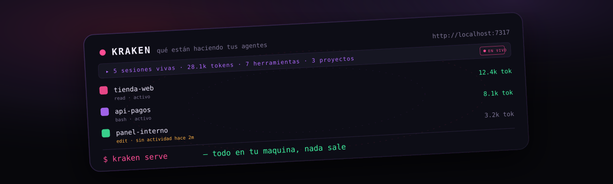
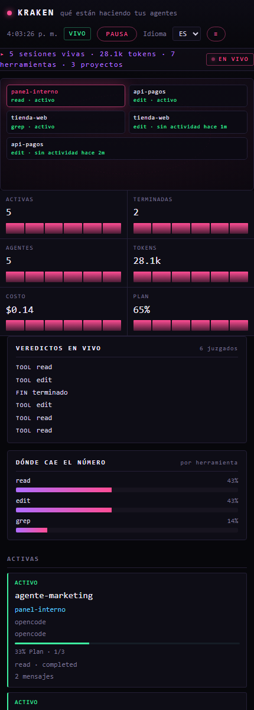

<div align="center">

# 🦑 Kraken

### The live panel for your coding agents. · El panel en vivo de tus agentes de código.

[](https://www.npmjs.com/package/@fabianmelomaciel/kraken)
[](LICENSE)
[](https://nodejs.org)



</div>

---

A local panel to watch, live, what your coding agents are up to. Active
sessions on top, finished ones at the bottom, with tokens, cost, tools, diffs,
checklists and subagents. Everything runs on your machine: the monitor reads
what the IDEs already wrote and sends nothing anywhere.


It is a cross-platform product: Windows, macOS and Linux. Zero runtime
dependencies, no telemetry, no update check, no `postinstall`.

## Install

```bash
npm i -g git+https://github.com/fabianmelomaciel/kraken.git
```

Or without installing anything:

```bash
npx git+https://github.com/fabianmelomaciel/kraken.git serve
```

You need **Node 22.13 or newer**: the opencode database is read with
`node:sqlite`, which is still experimental. On an older Node the panel still
starts: it warns and keeps going with Claude Code and the events.

## Start

```bash
kraken serve
```

It listens on `http://localhost:7317` (fixed port by default) and opens the
browser. The first load carries the token in the query string:

```
http://localhost:7317/?token=<128 bits in hex>
```

The panel stores it in `localStorage`, takes it out of the URL and from then
on sends it in the header. To pin a port:

```bash
kraken serve --port 8080
```

Flags: `--port N` (0 = ephemeral), `--host H`, `--no-browser`, `--lang es|en|pt`,
`--dir PATH` (state somewhere else, for testing).

The panel only listens on `127.0.0.1` and validates the `Host`: anything but
`127.0.0.1:<port>` or `localhost:<port>` gets a 403. With `--host` pointing
somewhere else it warns on the console that it is exposed to the network.

If 7317 is taken the panel tries 7318, and so on up to 7327: if those run out
it falls back to an ephemeral port. It never ends up without a port and it
never dies because a port was busy.

## The URL and the token

The 128 bit token never shows up on the console. The URL that carries it is
asked for explicitly:

```bash
kraken url      # prints the URL with the token
kraken open     # opens that URL in the browser
```

`kraken url` builds the URL with the port that ended up listening and the token
from the state file (mode 0600). `kraken open` does the same and opens it: the
URL is validated before touching the system (only `localhost` or `127.0.0.1`
with a numeric port, no control characters) and it never goes through a shell.
If the machine has no browser, `kraken open` prints the URL and exits 0.

## The autostart

`kraken autostart` makes the monitor start on login and, besides writing the
file, it **activates** it on every system:

| OS | What it writes | What it activates |
| --- | --- | --- |
| Windows | `Kraken.cmd` in the Startup folder | the Startup folder runs it on the next login; the `.cmd` leaves a log in `autostart.log` |
| macOS | `~/Library/LaunchAgents/io.kraken.plist` | `launchctl bootstrap` (and `bootout` on uninstall) |
| Linux | `~/.config/systemd/user/io.kraken.service` | `systemctl --user daemon-reload` and `enable --now` (and `disable` on uninstall) |

On macOS `KeepAlive` is on failure and on Linux `Restart=on-failure` with
`RestartSec=5`: if the monitor crashes it comes back on its own. If the system
command fails (permissions, no systemd), it warns on the console and keeps
going.

By default the autostart does **not** open the browser. The flag does:

```bash
kraken autostart --con-navegador
```

On macOS and Linux the flag turns into the launcher option; on Windows the
`.cmd` calls `kraken open` after the monitor starts. To take it all back:
`kraken autostart --remove`. `kraken doctor` tells you whether the autostart
is installed **and** whether it is active on this machine.

## The three sources

| Source | Where | What comes out |
| --- | --- | --- |
| opencode | `~/.local/share/opencode/opencode.db` | sessions, agent, model, tokens, cost, diff, todos, tool, subagents |
| Claude Code | `~/.claude/projects/*/*.jsonl` | sessions, model, tokens, tool, subagents |
| events | the state JSONL | triggers the tick and says which session finished |

**Official sources: opencode and Claude Code.** For Cursor, Antigravity and
Copilot there is an **ingestion contract**, not a native integration: those
IDEs leave no readable data in a stable format, so the monitor does not
guess. If your agent can expose events, send them yourself:

```bash
kraken emit --kind session.step --sid my-agent --src cursor --tool read
```

or over HTTP:

```bash
curl -X POST http://127.0.0.1:7317/api/event \
  -H "X-Kraken-Token: <the token>" \
  -H "Content-Type: application/json" \
  -d '{"kind":"session.step","sid":"my-agent","src":"cursor","tool":"read"}'
```

The JSONL is no longer the source of truth: it **triggers** the read and is
the only thing that can mark a session as finished. If the plugin or the hook
does not say so, the panel says "idle for Xm" and never invents the end.

## Instrumenting the IDEs (opt-in)

The monitor **does not touch your IDEs** by default. `kraken install-ide` is
for whoever wants the exact "it finished" signal and the live trigger:

```bash
kraken install-ide          # install
kraken install-ide --dry-run  # show what it would do
```

The installer does two things:

1. copies the plugin to `~/.config/opencode/plugins/` (`kraken-feed.js` plus
   `kraken-eventos.js`);
2. merges the Claude Code hooks into `~/.claude/settings.json` (backup in
   `.bak`, never replaces what was there).

It is idempotent: run it as many times as you want. And `kraken uninstall`
takes everything back: it removes the plugin, restores the hooks from the
`.bak`, drops the autostart and clears the state (`--keep-state` leaves it).

### Claude Code hooks

| Hook | What it records |
| --- | --- |
| `SessionStart` | opens the card |
| `UserPromptSubmit` | the session moved again |
| `PreToolUse` | one more step (with the tool name) |
| `Stop` / `SessionEnd` | closes the card |

## What it shows and what it does not

Per session: name, project, IDE, agent, model, state, bar, tokens (input,
output, cache), cost, duration, last tool and its state, diff `+add/−del`,
message count, task checklist and nested subagents.

Global: active sessions, finished ones, live agents, accumulated tokens,
accumulated cost, global percentage (only with a real denominator), the clock
of the last read, the status light and the project column.

**Never leaves the machine**: the text of the prompts, the text of the
answers, `tool.input` nor `tool.output`. Everything that does leave goes
through a secret filter (`sk-…`, `ghp_…`, `AKIA…`, private keys, `Bearer …`,
JWT, `npm_…`) and a 200 character cap per field.

The snapshot **carries no absolute paths**: a project shows up with its name
and a short hash of the path, so the panel does not tell which folder you
live in. The allowlist inside still uses the full path.

The HTML render is `textContent` and `createElement` only: there is no
`innerHTML` anywhere.

## The allowlist

The allowlist defaults to **auto mode**: you see the projects your IDEs already
know — the ones you actually work in — and nothing else. To narrow it down,
write `permisos.json` in the config folder with the roots you want (an empty
list denies everything):

| OS | Path |
| --- | --- |
| Windows | `%APPDATA%\Kraken\permisos.json` |
| macOS | `~/Library/Application Support/Kraken/permisos.json` |
| Linux | `$XDG_CONFIG_HOME/kraken/permisos.json` (or `~/.config/kraken/permisos.json`) |

```json
{
  "raices": ["C:\\proyectos\\mi-repo", "/home/usuario/codigo"],
  "dias": 30,
  "nivel": "metadata"
}
```

- `raices`: a session whose directory falls under no root is **not shown**.
  An empty list denies everything.
- `dias`: Claude Code transcripts older than this are not even read.
- `nivel`: `metadata` is the only implemented level. Prompt text is never
  exposed at any level.

`kraken doctor` tells you where everything is and whether the sources are
there.

## Security

- A **128 bit token is mandatory** on every `/api/*` route: no token (or the
  wrong one) gets a 401. It lives in the state file, mode 0600.
- The IDE database is opened **read-only**: `readOnly`,
  `PRAGMA query_only=1` and `busy_timeout`. The monitor never creates the
  database and never indexes it.
- The HTML CSP carries a nonce per response and no `unsafe-inline`.
- The state lives in the OS folder (`%LOCALAPPDATA%\Kraken`,
  `~/Library/Application Support/Kraken`, `$XDG_STATE_HOME/kraken`).
  **Never** in Documents, Desktop, Dropbox or iCloud.
- `/api/events` caps at 24 clients and the frames have a byte cap.
- The state directory is created with mode `700` and the files with `600`
  (on Windows the mode is a warning: there are no POSIX permissions to honour).

## The panel

- Active sessions are **always on top** and, when the order changes, the
  panel scrolls itself up. If you scrolled by hand, it does not step on you.
- Finished sessions are **only the last 5**: the rest never enter the
  snapshot, so they are not in anyone's DOM either.
- In portrait it is a single column, with no horizontal scroll.
- The product name and the labels come in Spanish, English and Portuguese,
  with autodetection (`navigator.language`), `?lang=` and a selector in the
  bar.
- The **tape** on top carries the numbers of the snapshot (live sessions,
  tokens, tools, projects) and a `live` badge.
- The **orbit** shows up to 24 live sessions as cards: project, tool and
  state. In portrait they become a grid of chips so none of them gets cut.
- **Live verdicts** is the feed of what changed between one snapshot and the
  next: the tool that ran, the plan progress, the closing. Never the text of
  a prompt, never the text of a task.
- **Where the number lands** splits the tools by their real denominator: with
  no denominator, the section does not show up.
- The **Pause** button freezes the render in the browser. It does not cut the
  stream and nothing goes out to the network: the state lives in the
  `localStorage`.
- The six metrics carry their sparkline: the history lives in the browser, the
  server does not keep a second of data just to draw it.



## The commands

```bash
kraken serve [--port N] [--host H] [--no-browser] [--lang es|en|pt]
kraken url
kraken open
kraken install-ide [--dry-run]
kraken uninstall [--keep-state]
kraken autostart [--remove] [--con-navegador]
kraken emit [--kind K] [--sid S] [--src X] [--title T] [--tool T] [--step N] [--total N] [--project P]
kraken doctor
```

`kraken autostart` makes the monitor start on login: Startup folder on
Windows, a LaunchAgent on macOS, a `systemd --user` unit on Linux. **Always
with `--no-browser`**: opening a tab on every login is a nuisance, and on a
shared machine it is a problem. `kraken autostart --remove` undoes it.

## Routes

| Route | What it is |
| --- | --- |
| `GET /` | the panel |
| `GET /api/state` | JSON snapshot (with an ETag: 304 when unchanged) |
| `GET /api/events` | SSE with the snapshot when it changes |
| `POST /api/event` | event ingestion |

Any other route gets a 404 (the favicon gets a 204: it does not exist and
there is no need to say anything about it). The SSE sends the full snapshot to
every new client and then only when something changed: **in idle there are no pushes**.
If the SSE drops, the panel falls back to polling `/api/state`.

The clock adapts: with activity it reads every 3 seconds, idle every 30. A
new event triggers the refresh at 120 milliseconds. The timers are `unref`ed
and the JSONL rotates at 5 MB (three copies) resetting the offset.

## Test

```bash
node test/kraken.test.js
```

It starts the server with invented fixture data — never with yours — and
checks the token, the allowlist, the snapshot without absolute paths, the cap
on finished sessions, the order, portrait, the i18n, the degradation without
`node:sqlite` and the privacy boundary. It runs on Windows, macOS and Linux.

## License

MIT. [Versión en español](README.md).

<div align="center">


</div>
